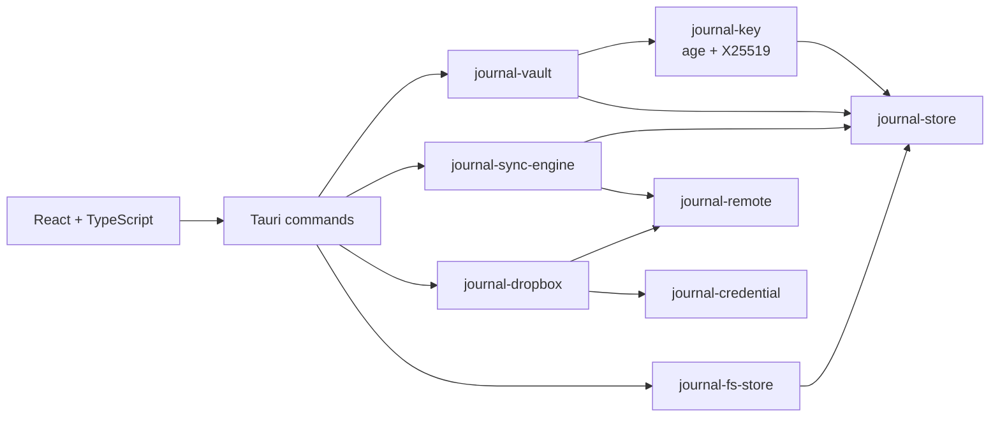

# Journal

[](https://github.com/f-squirrel/journal/actions/workflows/ci.yml)
[](https://codecov.io/github/f-squirrel/journal)

A private, local-first journal with Markdown editing and encrypted storage.
The interface is built with React and runs in a native
[Tauri 2](https://v2.tauri.app/) shell backed by Rust.

> [!WARNING]
> Journal is alpha software. Storage formats, APIs, and features may change
> without a migration path. There are no releases or external users yet. Do
> not trust it as the only copy of writing you cannot afford to lose.

## What works today

- A three-pane desktop interface that collapses to one column at phone width
- Markdown editing with syntax highlighting and rendered read mode
- Inline autosave—there is no Save button
- Passphrase-protected journals that lock after 10 seconds without input
- One independently encrypted blob per entry
- Local filesystem storage
- Light and dark themes
- Dropbox sync, with per-entry upload and conflict marks; a second device
  joins an existing journal by connecting Dropbox from the login screen

Google Drive, iCloud, iOS, and Android support are planned.

## Run it

### Prerequisites

Run `make setup` (or `scripts/setup.sh`). It installs everything below on
macOS (needs [Homebrew](https://brew.sh); prompts for the Xcode command line
tools) and Debian/Ubuntu (uses `sudo` for apt), and is safe to re-run. It also
takes `--system`, `--rust`, `--js` and `--coverage` to run single steps;
`make coverage` needs `scripts/setup.sh --coverage` once.

To set up by hand instead:

- [Node.js 22](https://nodejs.org/) and npm
- The [stable Rust toolchain](https://rustup.rs/)
- GNU Make
- The [system dependencies required by Tauri](https://v2.tauri.app/start/prerequisites/)

Install the JavaScript dependencies and launch the native app:

```sh
npm ci
make run
```

On first launch, entering a passphrase creates a new journal. Later launches
require the same passphrase; there is no password recovery.

### Enabling Dropbox sync

Sync needs a Dropbox app key at build time. Create a Dropbox app with "App
folder" access, allow the redirect URI `http://127.0.0.1:53682/`, tick the
scopes `files.metadata.read`, `files.content.read`, `files.content.write` and
`account_info.read` in its Permissions tab, and launch with its key:

```sh
DROPBOX_APP_KEY=your-app-key make run
```

A build without the key runs normally, and the key can instead be entered in
Settings › Sync, or on the login screen of a device with no journal yet. Use the
same key on every device: each app has its own Dropbox folder.

Release builds use one production Dropbox app, registered and owned by the
maintainer. Its key is public (the flow is PKCE, with no client secret), but
a release job supplies it from a CI secret, `DROPBOX_APP_KEY`, so that forks
do not ship under this app's name. Dropbox caps an app in development at 500
linked users; it must pass Dropbox's production review before a release
reaches more.

To use one journal on a second device, connect Dropbox from that device's login
screen *before* creating a journal there. A device that creates its own journal
first holds a different key, and sync stops with a key mismatch; see
[`docs/known-issues.md`](docs/known-issues.md).

### Frontend-only development

```sh
npm run dev
```

This runs the interface in a browser with seeded, in-memory entries. It does
not use the Rust backend, persist data, or exercise encryption. Use `make run`
when testing real application behavior.

## Development commands

| Command | Purpose |
| --- | --- |
| `make run` | Regenerate bridge types and launch the Tauri app |
| `make build` | Check bridge types and build native installers |
| `make test` | Run all Rust and Playwright tests |
| `make rust-test` | Run the Rust workspace tests |
| `make test-e2e` | Run the browser-based Playwright suite |
| `make coverage` | Measure line coverage of the Rust and front-end tests and print the totals and the changed lines no test ran; quiet by default, `V=1` for the full output |
| `make coverage-open` | Open the HTML coverage reports in the browser |
| `npm run build` | Type-check and build the frontend |
| `make bindings` | Regenerate TypeScript types from Rust wire types |
| `make check-bindings` | Fail if generated bridge types are stale |
| `make check-no-fallback` | Ensure development seed data is absent from production |
| `make format` | Format Rust and TypeScript sources |

The end-to-end tests use the browser's in-memory backend. Rust tests cover the
vault, encryption, storage, synchronization, Dropbox protocol behavior, and
Tauri command wiring without requiring network access.

The coverage badge is the total over both languages. Test code is left out of
it. The front end has no unit tests, so its share is what the Playwright suite
reaches. `make coverage` needs a nightly toolchain with `llvm-tools-preview`
and `cargo-llvm-cov` (`cargo binstall cargo-llvm-cov`), and writes
`coverage/rust-html/` and `coverage/web-html/`.

## Architecture



Arrows point from a component to what it depends on. The application keeps
platform glue in `src-tauri` and places backend behavior in small Rust
workspace crates:

| Path | Responsibility |
| --- | --- |
| `src/` | React UI, routing, autosave, and the Tauri API wrapper |
| `src-tauri/` | Native application setup and Tauri commands |
| `crates/entry` | Shared entry and header types |
| `crates/api` | Frontend contract: bridge-only types, entry types re-exported |
| `crates/key` | Key creation, sealing, unlocking, and encryption |
| `crates/vault` | Encrypted entry CRUD and journal rules |
| `crates/store` | Abstract local blob-store interface |
| `crates/fs-store` | Filesystem blob-store implementation |
| `crates/remote` | Revision-aware remote-store interface |
| `crates/sync-engine` | Local-first, clock-free synchronization engine |
| `crates/credential` | Provider-neutral saved login (refresh token) |
| `crates/dropbox` | Dropbox remote store and OAuth PKCE flow |
| `e2e/` | Playwright UI tests |
| `docs/adrs/` | Architecture decision records |
| `docs/known-issues.md` | Known problems deliberately left unfixed |

Rust owns the wire format. TypeScript definitions in `src/bindings/` are
generated from Rust with `ts-rs` and should not be edited by hand.

## Storage and security

Entries are serialized as JSON, encrypted with
[`age`](https://github.com/FiloSottile/age) to an X25519 identity, and written
as separate blobs in the platform's application-data directory. The identity
is sealed with the journal passphrase using scrypt and stored as one more blob
beside the entries. The passphrase is never stored.

With sync connected, those same encrypted blobs, including the sealed key,
are copied to the Dropbox app folder. Dropbox never sees plaintext or the
passphrase. It does hold everything else an attacker would need to try
guessing the passphrase offline.

This design protects journal contents at rest, but it has not received an
independent security audit. Losing either the passphrase or the sealed key
means losing access to the journal. Sync is not a backup: deletions and edits
propagate, and no earlier versions are kept. Backups and data migration are
not implemented.

## Further reading

- [`CLAUDE.md`](CLAUDE.md) — detailed architecture and contributor guidance
- [`docs/adrs/`](docs/adrs/README.md) — decisions and their trade-offs
- [`docs/known-issues.md`](docs/known-issues.md) — known problems left
  unfixed, with workarounds
- [`crates/sync-engine/README.md`](crates/sync-engine/README.md) — synchronization model
- [`crates/dropbox/README.md`](crates/dropbox/README.md) — Dropbox integration
